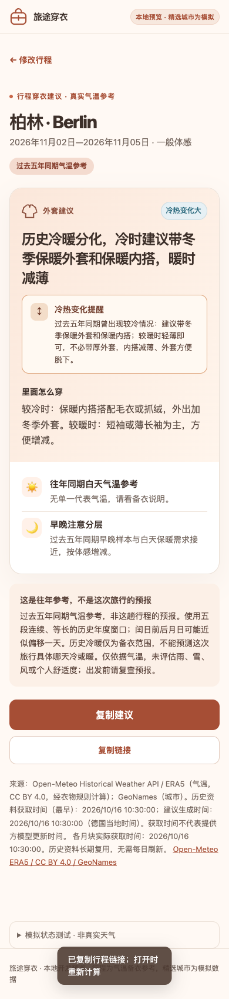

# Phase 2B local verification — 2026-10-16

Scope: Issue #21 and merged five-year specifications at `efea364`. Python standard library; existing experimental eight-year CLI and Phase 2A forecast algorithm preserved. No live archive/geocoding smoke, bulk download, hosted storage provisioning, deployment or merge was performed.

## Results

| Check | Result |
| --- | --- |
| `python3 -m unittest discover -s tests/web -q` | 43 tests passed, including loopback historical HTTP success/503 |
| `python3 -m unittest discover -s experiments/clothing-rules -q` | 122 tests passed |
| `node tests/web/history-browser.cjs` | 22 checks passed |
| `UI_BASE_URL=http://127.0.0.1:8001 node tests/web/browser.cjs --check-only` | 63 checks passed |
| `UI_BASE_URL=http://127.0.0.1:8001 node tests/web/featured-regressions.cjs` | 10 regression scenarios passed |
| `node tests/web/live-browser.cjs --check-only` | 25 Phase 2A checks passed |
| `UI_BASE_URL=http://127.0.0.1:8001 node tests/web/review-regressions.cjs --check-only` | 35 Phase 2A checks passed |
| `node --check web/static/app.js`, `git diff --check` | Passed |

All weather and geocoding in these runs was synthetic/injected; browser requests used only loopback. The history browser script routes full JSON calculated by the Python service into the unchanged V5 result layout. It checks five-year wording, independent acquisition/calculation labels, null main indicator/temperature, explicit winter outerwear and inner layers, no future cold-date claims, copy/share, restored form dates and the full 30-day input range. It checks horizontal overflow at 320/375/390/430/1280px. The screenshot below was visually inspected at 390px; it is **synthetic test evidence, not real ERA5 weather**.

## Historical acceptance coverage

- Five missing November blocks generate five fake HTTP requests / 30 conservative equivalent calls. Overlap, reload, date/sensitivity changes and complete reads add zero archive calls. Extending into December adds only its five blocks; another city/coordinate version uses separate objects.
- Full month identity/checksum/unit/numeric/order/UTC-hour validation; both DST transitions including 743-hour March and 745-hour October; boundary padding normalization; missing hours, malformed JSON/gzip, oversized expansion, changed model/coordinates and storage IO failure.
- The exact Dec/Jan, leap-containing and leap-start examples each produce five consecutive equal-duration windows. Sample reads and missing-block failure are tested for all three mappings.
- Interrupted two-block execution survives restart; no partial five-year answer. Month writes publish atomically. Failed storage publication never creates a valid month. A second worker/reader is refused promptly during maintenance; successful months are not duplicated after restart.
- Batch/daily/monthly limits, persistent failed-attempt reservations, German day/month rollover, 429/500/503 cooldown with longer numeric Retry-After, total worker timeout, admission limit before any download, corrupt quota ledger, incomplete latest month with no substitute year, and German date change during advice.
- Stable historical conditions yield null variation; meaningful L2/L6 samples explicitly cover winter outerwear and inner layers. An even split has null main temperature/level and still gives concrete cold/warm clothing. Early/evening risks and 13°C copy tolerance are preserved. Historical wording never imports forecast date claims.
- Manual command dry-run makes zero requests and reports fewer missing months after partial initialization. Upcoming priority planning includes all possible actual mapped months and places them across supplied cities before optional annual backfill.

## Synthetic timing and request baseline

One local in-memory run: five November blocks prefetched in **4.57 ms**; median complete query over 20 runs **2.98 ms**. Prefetch used **5 synthetic HTTP attempts / 30 estimated equivalent calls**; the subsequent 20 reads used **zero** archive calls. These measure local Python normalization/serialization/read/calculation only, with no real network or hosted storage latency. Actual live upstream requests made during this Phase 2B verification: **0**. This is not a production latency or cost claim.

## Reproduction and remaining boundary

Start `python3 -m web.server --fixtures --port 8001` for fixture/browser suites. The deterministic Phase 2A server command is in `web/README.md`. `history-browser.cjs --capture` refreshes this screenshot; other suites accept `--check-only` to preserve older verification images.

The local history library must be explicitly initialized from operator-managed German city metadata and approved, bounded downloads before real historical answers can appear. Initialization commands, per-run limits, source attribution and the storage/coordination contract are documented in [web/README.md](../../../web/README.md). Web requests are read-only by default; missing/corrupt storage fails clearly. Shared object storage, distributed coordination, real data seeding and live latency/quota checks are owned by Phase 2D. Real featured snapshots/shared forecast updates remain Phase 2C.
